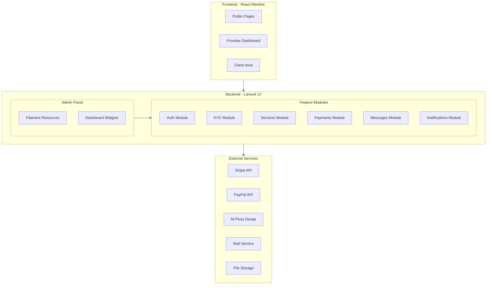
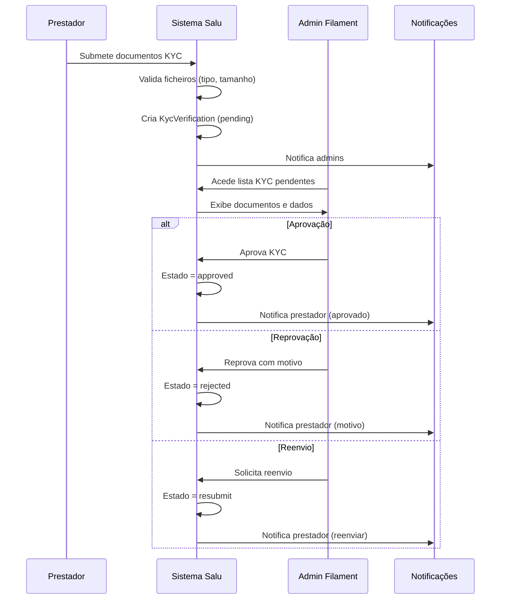
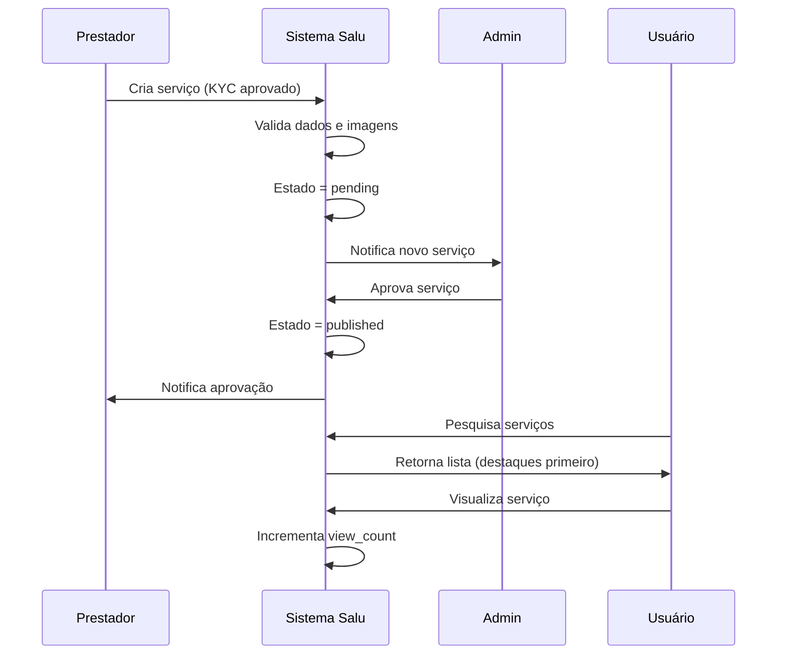
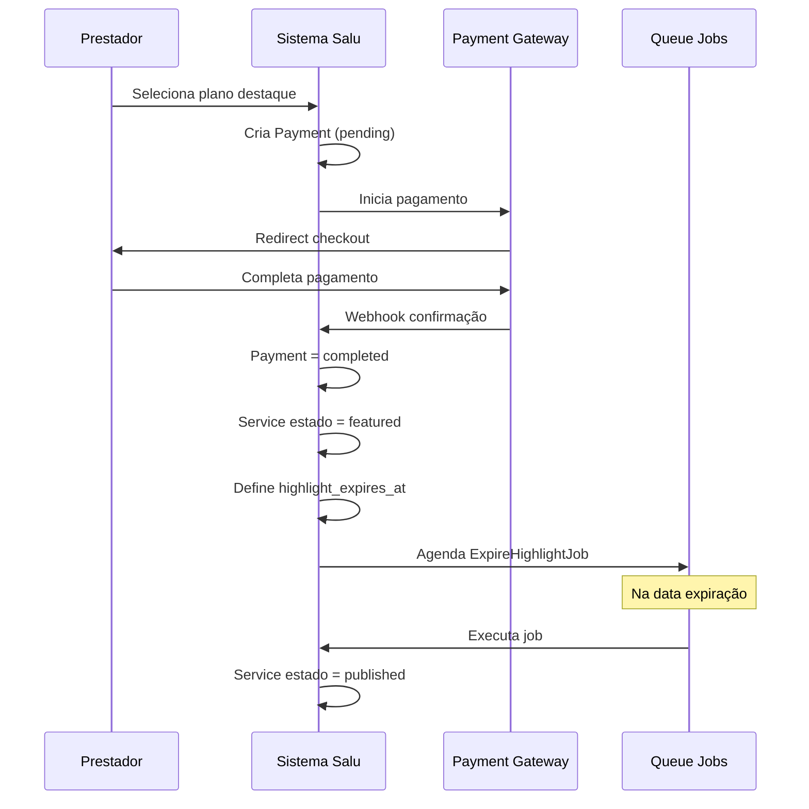
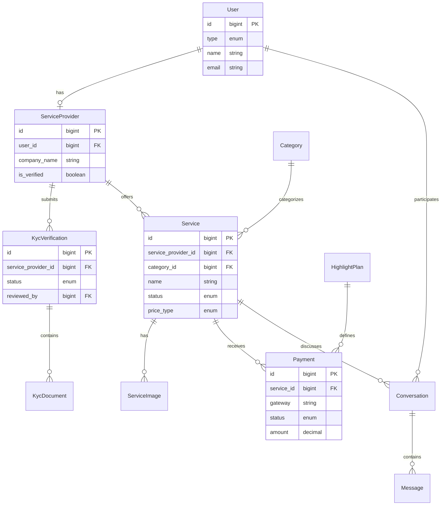

# Design Document - Salu Service Marketplace

## Overview

**Purpose**: A plataforma Salu é um marketplace de serviços que conecta usuários comuns a prestadores de serviços verificados, permitindo descoberta, comunicação e contratação de serviços com sistema de destaques pagos.

**Users**:
- **Usuários comuns** (clientes) pesquisam e contratam serviços
- **Prestadores de serviços** criam perfis, passam por KYC e publicam serviços
- **Administradores** gerem a plataforma através do painel FilamentPHP

**Impact**: Sistema greenfield que estabelece a arquitectura base para um marketplace escalável com verificação de identidade, gestão de serviços e monetização via destaques pagos.

### Goals

- Implementar autenticação multi-perfil (cliente, prestador, admin)
- Criar sistema KYC com workflow de aprovação e histórico
- Desenvolver módulo completo de serviços com categorias, imagens e estados
- Implementar busca e filtros avançados com priorização de destaques
- Integrar múltiplos gateways de pagamento para destaques
- Criar sistema de mensagens internas e notificações
- Desenvolver painel administrativo completo em FilamentPHP
- Migrar frontend para Mantine UI mantendo consistência visual

### Non-Goals

- Sistema de avaliações/reviews (mencionado como futuro nos requisitos)
- Real-time messaging com WebSockets (MVP usa polling)
- Processamento de pagamentos de contratação (apenas destaques)
- Multi-tenancy ou white-label
- Mobile apps nativos

---

## Architecture

### Existing Architecture Analysis

**Estado Actual**:
- Laravel 12 + Breeze com Inertia.js + React configurado
- FilamentPHP 3.2 com AdminPanelProvider funcional
- Models: User (com tipos), ServiceProvider (básico)
- Filament Resources: UserResource, ServiceProviderResource
- Frontend: Componentes Breeze com Tailwind CSS

**Padrões a Preservar**:
- Estrutura Filament Resources com Pages separadas
- Inertia.js para SPA sem API separada
- Tipos de usuário via enum no model User
- Convenções Laravel PSR-12

**Pontos de Integração**:
- User → ServiceProvider (1:1 existente)
- HandleInertiaRequests middleware
- AdminPanelProvider para panel Filament

### Architecture Pattern & Boundary Map

**Selected Pattern**: Modular Monolith com Feature Folders

**Rationale**: Equilibra simplicidade de deploy com organização clara por domínio, adequado para escala inicial do marketplace.



**Domain Boundaries**:

| Domain | Responsibility | Owner Models |
|--------|----------------|--------------|
| Auth | Autenticação, registo, perfis | User |
| KYC | Verificação identidade, documentos | KycVerification, KycDocument |
| Services | Serviços, categorias, imagens | Service, Category, ServiceImage |
| Payments | Destaques, pagamentos, planos | Payment, HighlightPlan |
| Messages | Conversas, mensagens | Conversation, Message |
| Notifications | Alertas email e in-app | Notification (Laravel) |

**Steering Compliance**: Segue convenções Laravel, PSR-12, separação clara Frontend/Backend.

### Technology Stack

| Layer | Choice / Version | Role in Feature | Notes |
|-------|------------------|-----------------|-------|
| **Frontend** | React 18.2 + Mantine UI 7.x | Interface usuário, dashboards | Migração gradual de Tailwind |
| **SPA Bridge** | Inertia.js 2.0 + Ziggy 2.0 | Routing server-side para React | Já configurado |
| **Backend** | Laravel 12 + PHP 8.2 | API, business logic, routing | Base existente |
| **Admin Panel** | FilamentPHP 3.2 | CRUD admin, workflows KYC | Já configurado |
| **Database** | MySQL 8.0 / SQLite | Persistência relacional | Migrations Laravel |
| **File Storage** | Spatie Media Library 11 | Imagens e documentos | Plugin Filament disponível |
| **Payments** | Stripe PHP, savannabits/daraja | Gateways de pagamento | Adapter pattern |
| **Mail** | Laravel Mail + SMTP | Notificações email | Built-in |
| **Queue** | Laravel Queue (database) | Jobs assíncronos | Expiração destaques |

---

## System Flows

### KYC Verification Flow



### Service Publication Flow



### Highlight Payment Flow



---

## Requirements Traceability

| Requirement | Summary | Components | Interfaces | Flows |
|-------------|---------|------------|------------|-------|
| 1.1-1.6 | Registo e Autenticação | AuthController, User | RegisterRequest, LoginRequest | Auth Flow |
| 2.1-2.5 | Perfil Prestador | ServiceProvider, ProfileController | ProfileUpdateRequest | Profile Flow |
| 3.1-3.7 | KYC Verification | KycVerification, KycDocument, KycResource | KycService | KYC Flow |
| 4.1-4.7 | Gestão Serviços | Service, ServiceImage, ServiceController | ServiceRequest | Service CRUD |
| 5.1-5.5 | Aprovação Serviços | ServiceResource (Filament) | ServicePolicy | Approval Flow |
| 6.1-6.6 | Busca e Descoberta | SearchController, ServiceRepository | SearchRequest | Search Flow |
| 7.1-7.6 | Destaques Pagos | Payment, HighlightPlan, PaymentController | PaymentGatewayInterface | Payment Flow |
| 8.1-8.5 | Mensagens | Conversation, Message, MessageController | MessageRequest | Message Flow |
| 9.1-9.6 | Notificações | Notification classes, NotificationController | NotificationService | Event-driven |
| 10.1-10.8 | Painel Admin | Filament Resources, Widgets | - | Admin CRUD |
| 11.1-11.4 | Categorias | Category, CategoryResource | CategoryRequest | Category CRUD |
| 12.1-12.7 | Segurança | Policies, Middleware, Validation | - | Cross-cutting |
| 13.1-13.6 | Frontend | React Pages, Mantine Components | Props interfaces | UI Rendering |

---

## Components and Interfaces

### Summary Table

| Component | Domain | Intent | Req Coverage | Key Dependencies | Contracts |
|-----------|--------|--------|--------------|------------------|-----------|
| User | Auth | Modelo de usuário com tipos | 1.1-1.6 | - | State |
| ServiceProvider | Auth | Perfil do prestador | 2.1-2.5 | User (P0) | State |
| KycVerification | KYC | Registo de verificação | 3.1-3.7 | ServiceProvider (P0) | Service, State |
| KycDocument | KYC | Documentos submetidos | 3.1-3.4 | KycVerification (P0), Media (P0) | State |
| Service | Services | Serviço publicado | 4.1-4.7, 5.1-5.5 | ServiceProvider (P0), Category (P0) | Service, State |
| Category | Services | Categoria de serviços | 11.1-11.4 | - | State |
| Payment | Payments | Registo de pagamento | 7.1-7.6 | Service (P0), PaymentGateway (P0) | Service, API |
| HighlightPlan | Payments | Planos de destaque | 7.1 | - | State |
| Conversation | Messages | Conversa entre usuários | 8.1-8.5 | User (P0), Service (P1) | State |
| Message | Messages | Mensagem individual | 8.1-8.3 | Conversation (P0), User (P0) | State |
| KycResource | Admin | Filament Resource KYC | 10.4 | KycVerification (P0) | - |
| ServiceResource | Admin | Filament Resource Services | 10.6 | Service (P0) | - |
| PaymentGatewayInterface | Payments | Abstração gateways | 7.5 | External APIs (P0) | Service |

---

### Auth Domain

#### User (Existing - Extended)

| Field | Detail |
|-------|--------|
| Intent | Modelo central de autenticação com tipos de usuário |
| Requirements | 1.1, 1.2, 1.3, 1.6 |

**Responsibilities & Constraints**
- Autenticação e autorização base
- Tipos: admin, client, provider
- Relações com ServiceProvider, Conversations, Notifications

**Dependencies**
- Outbound: ServiceProvider — perfil prestador (P0)
- Outbound: Conversation — mensagens (P1)
- Outbound: Notification — alertas (P1)

**Contracts**: State [x]

##### State Management

```php
// Tipos de usuário
const TYPE_ADMIN = 'admin';
const TYPE_CLIENT = 'client';
const TYPE_PROVIDER = 'provider';

// Relações a adicionar
public function conversations(): BelongsToMany;
public function unreadNotifications(): HasMany;
```

---

### KYC Domain

#### KycVerification

| Field | Detail |
|-------|--------|
| Intent | Registo de verificação de identidade do prestador |
| Requirements | 3.1, 3.2, 3.3, 3.4, 3.5, 3.6, 3.7 |

**Responsibilities & Constraints**
- Gestão de estados KYC (pending, approved, rejected, resubmit)
- Associação com documentos submetidos
- Histórico de alterações de estado
- Bloqueia publicação de serviços se não aprovado

**Dependencies**
- Inbound: ServiceProvider — pertence ao prestador (P0)
- Outbound: KycDocument — documentos associados (P0)
- Outbound: User (admin) — quem aprovou/reprovou (P1)

**Contracts**: Service [x] / State [x]

##### Service Interface

```php
interface KycServiceInterface
{
    /**
     * Submete nova verificação KYC
     * @throws ValidationException se documentos inválidos
     */
    public function submit(ServiceProvider $provider, array $documents): KycVerification;

    /**
     * Aprova verificação KYC
     * @throws AuthorizationException se não admin
     */
    public function approve(KycVerification $kyc, User $admin): KycVerification;

    /**
     * Reprova verificação com motivo
     */
    public function reject(KycVerification $kyc, User $admin, string $reason): KycVerification;

    /**
     * Solicita reenvio de documentos
     */
    public function requestResubmit(KycVerification $kyc, User $admin, string $reason): KycVerification;

    /**
     * Verifica se prestador está aprovado
     */
    public function isApproved(ServiceProvider $provider): bool;
}
```

##### State Management

```php
// Estados possíveis
enum KycStatus: string {
    case PENDING = 'pending';
    case APPROVED = 'approved';
    case REJECTED = 'rejected';
    case RESUBMIT = 'resubmit';
}

// Schema
Schema::create('kyc_verifications', function (Blueprint $table) {
    $table->id();
    $table->foreignId('service_provider_id')->constrained()->cascadeOnDelete();
    $table->string('status')->default('pending');
    $table->text('rejection_reason')->nullable();
    $table->foreignId('reviewed_by')->nullable()->constrained('users');
    $table->timestamp('reviewed_at')->nullable();
    $table->timestamps();
});
```

**Implementation Notes**
- Observer para notificar em mudanças de estado
- Policy para restringir acções de aprovação a admins
- Histórico via tabela separada kyc_status_history

---

#### KycDocument

| Field | Detail |
|-------|--------|
| Intent | Documento individual submetido para KYC |
| Requirements | 3.1, 2.4 |

**Responsibilities & Constraints**
- Armazena referência ao ficheiro (via Spatie Media Library)
- Tipos: identity_document, selfie
- Validação de extensão (jpg, png, pdf) e tamanho (5MB)

**Dependencies**
- Inbound: KycVerification — pertence à verificação (P0)
- External: Spatie Media Library — gestão de ficheiros (P0)

**Contracts**: State [x]

##### State Management

```php
// Schema
Schema::create('kyc_documents', function (Blueprint $table) {
    $table->id();
    $table->foreignId('kyc_verification_id')->constrained()->cascadeOnDelete();
    $table->string('type'); // identity_document, selfie
    $table->string('original_filename');
    $table->timestamps();
});

// Model usa InteractsWithMedia trait
// Collection 'kyc' com conversions para thumbnails
```

---

### Services Domain

#### Service

| Field | Detail |
|-------|--------|
| Intent | Serviço oferecido por prestador |
| Requirements | 4.1, 4.2, 4.3, 4.4, 4.5, 4.6, 4.7, 5.1, 5.2, 5.3, 5.4, 5.5 |

**Responsibilities & Constraints**
- Core entity do marketplace
- Estados: pending, published, suspended, featured
- Preços: fixed, variable, hourly
- Estatísticas: views, clicks, conversions
- Apenas prestadores KYC aprovados podem criar

**Dependencies**
- Inbound: ServiceProvider — pertence ao prestador (P0)
- Inbound: Category — categorização (P0)
- Outbound: ServiceImage — galeria de imagens (P0)
- Outbound: Conversation — mensagens sobre serviço (P1)

**Contracts**: Service [x] / State [x]

##### Service Interface

```php
interface ServiceServiceInterface
{
    /**
     * Cria novo serviço (requer KYC aprovado)
     * @throws AuthorizationException se KYC não aprovado
     */
    public function create(ServiceProvider $provider, array $data): Service;

    /**
     * Atualiza serviço existente
     */
    public function update(Service $service, array $data): Service;

    /**
     * Remove serviço e imagens associadas
     */
    public function delete(Service $service): bool;

    /**
     * Pesquisa serviços com filtros
     */
    public function search(SearchCriteria $criteria): LengthAwarePaginator;

    /**
     * Incrementa contador de visualizações
     */
    public function incrementViews(Service $service): void;
}
```

##### State Management

```php
enum ServiceStatus: string {
    case PENDING = 'pending';
    case PUBLISHED = 'published';
    case SUSPENDED = 'suspended';
    case FEATURED = 'featured';
}

enum PriceType: string {
    case FIXED = 'fixed';
    case VARIABLE = 'variable';
    case HOURLY = 'hourly';
}

// Schema
Schema::create('services', function (Blueprint $table) {
    $table->id();
    $table->foreignId('service_provider_id')->constrained()->cascadeOnDelete();
    $table->foreignId('category_id')->constrained();
    $table->string('name');
    $table->text('description');
    $table->string('price_type');
    $table->decimal('price_min', 10, 2);
    $table->decimal('price_max', 10, 2)->nullable();
    $table->string('location')->nullable();
    $table->string('delivery_time')->nullable();
    $table->json('tags')->nullable();
    $table->string('status')->default('pending');
    $table->unsignedBigInteger('view_count')->default(0);
    $table->unsignedBigInteger('click_count')->default(0);
    $table->unsignedBigInteger('conversion_count')->default(0);
    $table->timestamp('highlight_expires_at')->nullable();
    $table->timestamps();

    $table->index(['status', 'highlight_expires_at']);
    $table->fullText(['name', 'description']);
});
```

---

#### Category

| Field | Detail |
|-------|--------|
| Intent | Categoria para organização de serviços |
| Requirements | 11.1, 11.2, 11.3, 11.4 |

**Responsibilities & Constraints**
- CRUD simples via Filament
- Ordenação alfabética
- Protecção contra exclusão com serviços associados

**Dependencies**
- Outbound: Service — serviços nesta categoria (P1)

**Contracts**: State [x]

##### State Management

```php
Schema::create('categories', function (Blueprint $table) {
    $table->id();
    $table->string('name');
    $table->text('description')->nullable();
    $table->string('icon')->nullable();
    $table->boolean('is_active')->default(true);
    $table->timestamps();

    $table->index('name');
});
```

---

### Payments Domain

#### Payment

| Field | Detail |
|-------|--------|
| Intent | Registo de pagamento de destaque |
| Requirements | 7.1, 7.2, 7.5, 7.6 |

**Responsibilities & Constraints**
- Regista transacções de pagamento
- Estados: pending, completed, failed, refunded
- Associa método (stripe, paypal, mpesa, simulation)
- Idempotency via external_id do gateway

**Dependencies**
- Inbound: Service — serviço a destacar (P0)
- Inbound: ServiceProvider — quem pagou (P0)
- Inbound: HighlightPlan — plano selecionado (P0)
- External: Payment Gateways (P0)

**Contracts**: Service [x] / API [x] / State [x]

##### Service Interface

```php
interface PaymentServiceInterface
{
    /**
     * Inicia processo de pagamento
     */
    public function initiate(
        Service $service,
        HighlightPlan $plan,
        string $gateway
    ): PaymentInitiation;

    /**
     * Processa webhook de confirmação
     */
    public function handleWebhook(string $gateway, array $payload): Payment;

    /**
     * Verifica status de pagamento
     */
    public function checkStatus(Payment $payment): PaymentStatus;
}

interface PaymentGatewayInterface
{
    public function createCheckoutSession(Payment $payment): CheckoutSession;
    public function verifyWebhook(array $payload, string $signature): bool;
    public function parseWebhookPayment(array $payload): WebhookPaymentData;
}
```

##### API Contract

| Method | Endpoint | Request | Response | Errors |
|--------|----------|---------|----------|--------|
| POST | /api/payments/initiate | `{service_id, plan_id, gateway}` | `{payment_id, checkout_url}` | 400, 402, 404 |
| POST | /webhooks/stripe | Stripe payload | 200 OK | 400 |
| POST | /webhooks/mpesa | M-Pesa callback | 200 OK | 400 |
| GET | /api/payments/{id}/status | - | `{status, details}` | 404 |

##### State Management

```php
enum PaymentStatus: string {
    case PENDING = 'pending';
    case COMPLETED = 'completed';
    case FAILED = 'failed';
    case REFUNDED = 'refunded';
}

Schema::create('payments', function (Blueprint $table) {
    $table->id();
    $table->foreignId('service_id')->constrained();
    $table->foreignId('service_provider_id')->constrained();
    $table->foreignId('highlight_plan_id')->constrained();
    $table->string('gateway'); // stripe, paypal, mpesa, simulation
    $table->string('external_id')->nullable()->unique();
    $table->decimal('amount', 10, 2);
    $table->string('currency', 3)->default('USD');
    $table->string('status')->default('pending');
    $table->json('gateway_response')->nullable();
    $table->timestamps();

    $table->index(['status', 'created_at']);
});
```

---

#### HighlightPlan

| Field | Detail |
|-------|--------|
| Intent | Plano de destaque disponível |
| Requirements | 7.1 |

**Contracts**: State [x]

```php
Schema::create('highlight_plans', function (Blueprint $table) {
    $table->id();
    $table->string('name');
    $table->integer('duration_days');
    $table->decimal('price', 10, 2);
    $table->string('currency', 3)->default('USD');
    $table->boolean('is_active')->default(true);
    $table->timestamps();
});

// Seed inicial
// 7 dias - $9.99
// 30 dias - $29.99
```

---

### Messages Domain

#### Conversation

| Field | Detail |
|-------|--------|
| Intent | Conversa entre usuário e prestador sobre serviço |
| Requirements | 8.1, 8.4 |

**Dependencies**
- Inbound: User (client) — participante (P0)
- Inbound: User (provider) — participante (P0)
- Inbound: Service — contexto opcional (P1)
- Outbound: Message — mensagens (P0)

**Contracts**: State [x]

```php
Schema::create('conversations', function (Blueprint $table) {
    $table->id();
    $table->foreignId('client_id')->constrained('users');
    $table->foreignId('provider_id')->constrained('users');
    $table->foreignId('service_id')->nullable()->constrained();
    $table->timestamp('last_message_at')->nullable();
    $table->timestamps();

    $table->unique(['client_id', 'provider_id', 'service_id']);
});
```

---

#### Message

| Field | Detail |
|-------|--------|
| Intent | Mensagem individual numa conversa |
| Requirements | 8.1, 8.2, 8.3 |

**Contracts**: State [x]

```php
Schema::create('messages', function (Blueprint $table) {
    $table->id();
    $table->foreignId('conversation_id')->constrained()->cascadeOnDelete();
    $table->foreignId('sender_id')->constrained('users');
    $table->text('content');
    $table->timestamp('read_at')->nullable();
    $table->timestamps();

    $table->index(['conversation_id', 'created_at']);
});
```

---

### Admin Domain (Filament)

#### KycVerificationResource

| Field | Detail |
|-------|--------|
| Intent | Gestão de verificações KYC no painel admin |
| Requirements | 10.4 |

**Implementation Notes**
- Lista com filtro por estado (pending prioritário)
- View com documentos e dados do prestador
- Actions: Aprovar, Reprovar (com modal motivo), Solicitar Reenvio
- Relation Manager para histórico de estados

---

#### ServiceResource

| Field | Detail |
|-------|--------|
| Intent | Gestão de serviços no painel admin |
| Requirements | 10.6 |

**Implementation Notes**
- Lista com filtros: estado, categoria, prestador
- Actions: Aprovar, Suspender, Excluir
- Infolist para visualização detalhada com galeria

---

#### CategoryResource

| Field | Detail |
|-------|--------|
| Intent | CRUD de categorias |
| Requirements | 10.5 |

**Implementation Notes**
- Form simples: nome, descrição, ícone
- Delete protegido se categoria tem serviços

---

#### PaymentResource

| Field | Detail |
|-------|--------|
| Intent | Visualização de pagamentos de destaque |
| Requirements | 10.7 |

**Implementation Notes**
- Lista read-only com filtros por data, gateway, prestador
- Exibe detalhes do gateway response

---

#### Dashboard Widgets

| Field | Detail |
|-------|--------|
| Intent | Estatísticas gerais no dashboard |
| Requirements | 10.1 |

**Implementation Notes**
- StatsOverviewWidget: total usuários, prestadores activos, serviços publicados, KYC pendentes
- ChartWidget: volume financeiro de destaques
- TableWidget: KYC pendentes recentes

---

## Data Models

### Domain Model



### Aggregates and Boundaries

| Aggregate Root | Entities | Value Objects | Invariants |
|----------------|----------|---------------|------------|
| User | ServiceProvider | - | Email único, tipo válido |
| KycVerification | KycDocument | KycStatus | Documentos obrigatórios para submissão |
| Service | ServiceImage | PriceType, ServiceStatus | KYC aprovado para criação |
| Conversation | Message | - | Dois participantes distintos |
| Payment | - | PaymentStatus | Serviço publicado para destaque |

---

## Error Handling

### Error Strategy

| Error Type | HTTP Code | Response Pattern | Recovery |
|------------|-----------|------------------|----------|
| Validation | 422 | `{errors: {field: [messages]}}` | Corrigir campos |
| Authentication | 401 | `{message: "Unauthenticated"}` | Login |
| Authorization | 403 | `{message: "Forbidden"}` | Verificar permissões |
| Not Found | 404 | `{message: "Resource not found"}` | Verificar URL |
| KYC Not Approved | 403 | `{message: "KYC approval required"}` | Completar KYC |
| Payment Failed | 402 | `{message: "Payment required", details}` | Retry pagamento |
| Rate Limited | 429 | `{message: "Too many requests"}` | Aguardar |

### Error Categories and Responses

**User Errors (4xx)**:
- Validação de formulários → mensagens por campo
- Upload inválido → tipo/tamanho do ficheiro
- KYC incompleto → redirect para perfil

**System Errors (5xx)**:
- Gateway timeout → retry com backoff
- Storage failure → graceful degradation (placeholder image)
- Queue failure → retry job

**Business Logic Errors (422)**:
- Serviço já destacado → mostrar data expiração
- Categoria com serviços → solicitar reatribuição

### Monitoring

- Laravel Telescope para debugging local
- Sentry/Bugsnag para erros produção
- Log channels: single (dev), stack (prod)
- Health check endpoint: `/health`

---

## Testing Strategy

### Unit Tests

- `KycServiceTest`: submissão, aprovação, rejeição, reenvio
- `ServiceServiceTest`: CRUD, validações, estatísticas
- `PaymentServiceTest`: iniciação, webhooks, status
- `SearchServiceTest`: filtros, ordenação, paginação

### Integration Tests

- `KycWorkflowTest`: fluxo completo prestador → admin → notificação
- `ServicePublicationTest`: criação → aprovação → listagem pública
- `PaymentFlowTest`: checkout → webhook → destaque activado
- `MessageFlowTest`: criação conversa → envio → notificação

### Feature Tests (Inertia)

- Páginas de registo e login
- Dashboard prestador
- Criação e edição de serviços
- Pesquisa e filtros públicos
- Inbox de mensagens

### Performance Tests

- Pesquisa com 10k+ serviços
- Upload concorrente de imagens
- Webhook processing rate

---

## Security Considerations

### Authentication & Authorization

- Laravel Sanctum para autenticação SPA
- Policies para cada model (ServicePolicy, KycPolicy, etc.)
- Middleware `verified` para acções sensíveis
- Rate limiting: 5 tentativas login / 15 min

### Data Protection

- Documentos KYC em storage privado
- Presigned URLs para acesso temporário
- Passwords hashed com bcrypt
- CSRF protection via Inertia

### File Upload Security

- Validação MIME type server-side
- Tamanho máximo 5MB
- Extensões: jpg, png, pdf
- Scan de conteúdo (opcional via ClamAV)

### Input Sanitization

- Laravel Request validation
- XSS prevention via Blade/React escaping
- SQL injection prevention via Eloquent

---

## Migration Strategy

### Phase 1: Foundation

1. Migrations para novos models (KYC, Service, Category, Payment, Message)
2. Instalar Spatie Media Library e Filament plugin
3. Criar Filament Resources básicos

### Phase 2: Core Features

1. Implementar KYC workflow
2. Implementar Services CRUD
3. Implementar busca e filtros
4. Criar páginas frontend Inertia

### Phase 3: Monetization

1. Integrar Stripe
2. Implementar destaques
3. Jobs de expiração

### Phase 4: Communication

1. Sistema de mensagens
2. Notificações email + in-app
3. Centro de notificações frontend

### Phase 5: Frontend Migration

1. Instalar Mantine UI
2. Migrar componentes gradualmente
3. Criar tema consistente

---

## Supporting References

Ver `research.md` para:
- Investigação detalhada Mantine + Inertia
- Comparação gateways de pagamento
- Configuração Spatie Media Library
- Padrões KYC workflow
